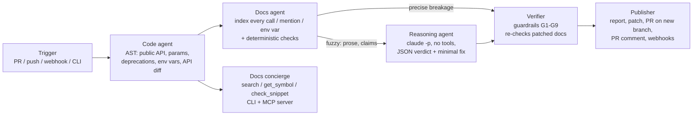

# DocSync: documentation that keeps up with the code

**Problem.** Docs rot quietly. Nobody notices until a user copies an example and gets a `TypeError`. We tested on **encode/httpx** (about 14k ★): DocSync found **two documentation errors that are still live on httpx `master`**, and both were confirmed by running the documented code. It also caught one that **shipped in 0.28.0 and took ~9.5 months to fix upstream**.

| Found by DocSync | Proof | Status upstream |
|---|---|---|
| `docs/advanced/extensions.md:169,179`: `httpx.get(..., extensions=...)` / `httpx.request(..., extensions=...)` | `TypeError: get() got an unexpected keyword argument 'extensions'` on httpx 0.28.1 | still on `master` |
| `docs/compatibility.md:200`: says `cert`/`mounts` "are available in `httpx.get`" | `TypeError ... 'cert'` on 0.28.1 | still on `master` (missed by maintainers in the 0.28 release) |
| `docs/advanced/ssl.md:74`: "httpx does not automatically pull in `SSL_CERT_FILE`" | `_config.py` reads it when `trust_env` | fixed in PR #3579, 2025-09-11 |

## 1. The workflow (multi-agent, with action and reasoning layers)

* **Code agent** (deterministic, no imports, safe on untrusted code). It reads the package with `ast` and builds the public API: signatures, docstrings, the environment variables the code reads, and **deprecations**. It finds deprecated parameters by spotting `warnings.warn(..., DeprecationWarning)` under an `if` that tests a parameter, then **follows keyword forwarding**: `Client(cert=)` → `_init_transport` → `HTTPTransport` → `create_ssl_context(cert=)`. Without that step, `Client(cert=...)` looks fine. It also diffs two refs into typed changes such as `param_removed` (with a rename hint), `param_deprecated(condition)` and `env_removed`.
* **Docs agent** indexes every Markdown page. It extracts calls in code blocks, strips `>>>` prompts, and resolves variables (`with httpx.AsyncClient() as c: c.get(...)` → `AsyncClient.get`). It also extracts prose mentions, `param=` spans and env vars, and skips blocks introduced as "not supported". **Static rules** (`STALE_SYMBOL`, `UNKNOWN_KWARG`, `DEPRECATED_KWARG`, `ENV_NOT_READ`) are precise enough to fail CI. **Review candidates** (`IMPACT`: prose touching something that changed; `ENV_CLAIM`: a negative claim about an env var the code reads) go to the LLM.
* **Reasoning agent** runs **one `claude -p` call per doc section**, 4 in parallel. It is given the section, the flags and *facts extracted from code*, including the library's own deprecation messages, which usually name the migration. It must return JSON: verdict `stale`/`ok`/`unsure`, a reason, and a minimal line-range fix. Calls run with **all tools disabled**, and doc text is marked as untrusted data. `CLAUDE_KEY` is passed as the OAuth token. Every answer is recorded to `cassettes/`, so runs are **replayable and auditable**, and CI is deterministic.
* **Verifier** applies each fix to an in-memory copy, and the fix only lands if it passes **G1** doc paths only, **G2** stays in its section, **G3** size budget, **G4** no new links, **G5** no secrets, **G6** no new broken code blocks, **G7** re-running the static checks shows the flag fixed and nothing new broken, **G8** confidence ≥ 0.7 (otherwise it becomes a suggestion), and **G9** no overlapping fixes.
* **Publisher** writes `report.md` (human-readable), `docs.patch`, `findings.json` and `trace.jsonl` (per-agent timing and LLM cost). Its hooks are a PR on a `docsync/*` branch (dry-run by default, never the default branch), a PR comment, and a generic JSON webhook (Slack, Teams or anything else). CI fails if confirmed `error`s remain.

**Changing how docs are served.** The same code model powers a **docs concierge**: `ask "use a client certificate"` returns API cards *generated from HEAD*, with the deprecation's own migration text and only **verified examples** (doc snippets that pass the checks today; broken ones are never served). `check snippet.py` lints a user's code against the current API, for example: *"`Client(verify='ca.pem')` is deprecated → use `verify=ssl.create_default_context(cafile=...)`"*. It is exposed as an **MCP server**, so Claude Code or Cursor answers from live API facts instead of stale pages.

## 2. Evaluation (`eval/results.md`, reproducible offline)

**E1: historical replay with human ground truth.** Code moves httpx 0.27.2 → 0.28.0, but the docs stay at 0.27.2 (a "forgot the docs" PR). There are 10 adjudicated stale spans: 7 the maintainers actually edited in 0.28.0, and 3 proven by execution. There are also 4 known traps: text that names a removed parameter (`proxies`) or env var but is still correct.

| operating point | recall | precision | notes |
|---|---|---|---|
| static rules only (no LLM) | 8/10 | **1.00** | safe to block CI |
| + all review candidates | 10/10 | 0.83 | fires on 2 traps |
| **+ reasoning agent verdicts** | **10/10** | **0.91** | dismisses the `requests`-related `proxies` line; 1 debatable flag remains |

All 17 fixes passed the guardrails, taking static findings from **12 → 0** after the patch. The SSL page rewrite converges on what the maintainers actually wrote (an `SSLContext` with `load_cert_chain`). In the audit of released 0.28.1 docs, recall is 3/4 with precision 1.00. The miss is the `compatibility.md:200` prose claim, which only surfaces when a diff touches `cert`, and it is reported honestly as a miss.

**E2: mutation benchmark.** We injected 24 API breaks into httpx 0.28.1 (removed parameter, new deprecation, renamed symbol). All 71 doc usages were caught, with **0 false alarms**.

**Cost and latency.** The code and docs agents take 0.6 s on httpx (24 pages, 572 doc references, 57 API changes). The replay scenario's 22 flags are grouped into **9 section-level LLM calls**, costing **$0.056 and ~28 s live** (4 in parallel), or 0.6 s when replayed. LLM cost scales with the number of *flagged sections*, not with repo size, because the 550 references that pass the deterministic checks never reach the LLM.

**Eval framework.** The ground truth is versioned JSON. Metrics are reported per operating point; mutation tests act as regression tests. Cassettes pin LLM behaviour, and re-recording with `--llm live` shows drift. Live verdicts vary slightly from run to run, which is why fixes still pass G1–G9.

## 3. Deploy and connect

* **GitHub Action** (`deploy/github-action.yml`): scan on every PR, comment the report, fail on broken examples. Without `CLAUDE_KEY` it still runs static rules (precision 1.0).
* **Service** (`deploy/Dockerfile`): `serve` takes GitHub webhooks verified with HMAC `X-Hub-Signature-256` plus a token-protected `POST /scan`. It runs as a non-root user, and secrets come only from env vars.
* **IDE / agents**: `claude mcp add docsync -- python -m src.docsync.cli mcp --head-dir <repo> --package <pkg>`.
* **Extending it**: a new language is a new code agent emitting the same `ApiModel`; a new sink is a function `(state, paths) -> None`.

**Limits and next steps:** Python packages and Markdown only for now. Audit mode can't see prose claims without a diff; an LLM "claims sweep" on a schedule would close that gap. Ground truth comes from one adjudicator (me), backed by maintainer edits and execution. The two httpx bugs above are worth upstreaming as a real PR.
